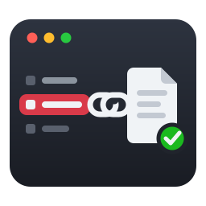
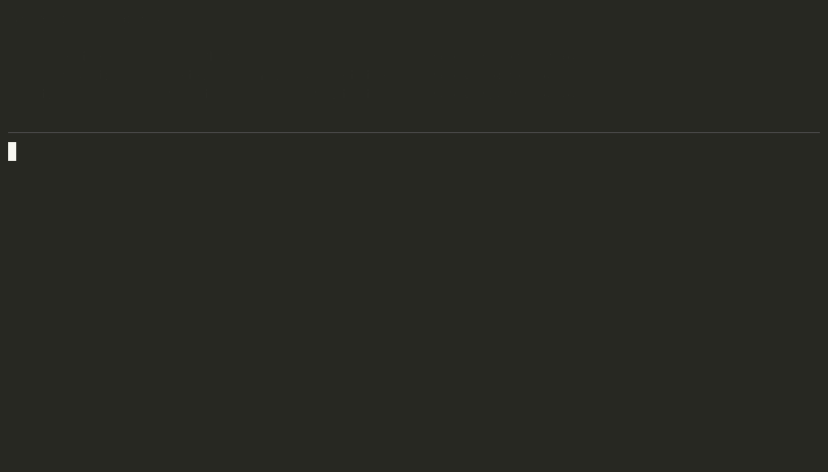

<p align="center">
  
</p>

<h1 align="center">zotero-relink</h1>

<p align="center"><b>Move and rename your PDFs however you like. Zotero keeps up.</b></p>

<p align="center">
  <a href="https://github.com/andrewboldi/zotero-relink/actions/workflows/test.yml"></a>
  <a href="LICENSE"></a>
  
  
</p>

Have you ever renamed a PDF, tidied a folder, or let a script reorganize your files, and then found
half your Zotero library saying *"The attached file could not be found"*?

zotero-relink keeps Zotero's linked files linked. Move or rename them however you like (in your file
manager, with `mv`, with `git`, or with a script), and within about ten minutes Zotero points to the new
place again.

<p align="center">
  
</p>

## How it works

- zotero-relink remembers what each linked file is: its inode, size and SHA-256.
- When a file goes missing, zotero-relink finds it again, first near where it was and then everywhere.
  A rename keeps the inode; a copy keeps the content.
- It updates the attachment's path through the Zotero Web API, and Zotero picks the change up at its
  next sync.
- It never writes Zotero's database, and it never guesses. If two files fit equally well, or the file
  was deleted, zotero-relink tells you and leaves the link alone.

## Install

```sh
curl -LsSf https://raw.githubusercontent.com/andrewboldi/zotero-relink/main/install.sh | sh
```

This installs zotero-relink and asks once for a Zotero API key with write access. It then runs every
10 minutes, with systemd on Linux or launchd on macOS.

`zotero-relink status` shows what the last run found, and `zotero-relink check` shows what it would
change without changing anything.

More: [how it works](docs/how-it-works.md) · [limitations](docs/limitations.md) ·
[uninstall](docs/how-it-works.md#uninstall) · [contributing](CONTRIBUTING.md)
